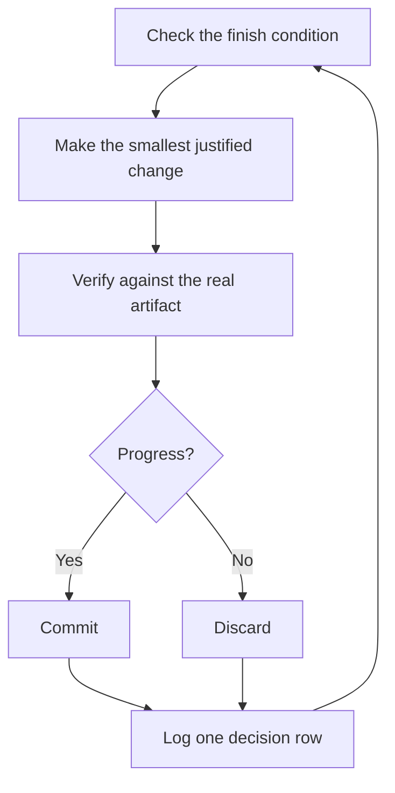

# Run work while you sleep

This is the payoff for everything before it. An agent you can trust to verify its own work is an agent you can leave alone with a hard task. What makes that safe isn't hope. It's a checkable finish condition, an isolated worktree, and a decision log you audit in the morning.


## Earn the trust before the loop

A loop you don't trust just produces unchecked work faster, and the mess compounds with every iteration. Before you leave one running, check that it has earned it:

- You've done the task once by hand, or watched an agent do it, so you know what good looks like.
- The agent has the tools and signals you'd use yourself: the verification skill, the profiler, the logs.
- Every stage proves its work and can stop the line when the work misses the bar.
- You've read a few transcripts and turned the repeated failures into tools, skills, or checks.

Make the loop autonomous only after all four hold. Until then, run it while you watch.

## The overnight contract

A good handoff has the goal, the finish condition, permissions, and an escape hatch. It doesn't need to be long:

```text
/maestro im going to bed. migrate every caller to the new parser in a fresh worktree off <base>.
done means zero old callers, all parser fixtures pass, old api deleted.
keep a decision log. don't ask me before committing.
/loop until done. if you're truly stuck after a few hours, stop and write up why.
```

Walk through what each line buys you:

- "im going to bed" is a session override. The agent stops asking and keeps going.
- "done means..." turns the goal into checks every iteration can run.
- "fresh worktree off `<base>`" keeps the run from colliding with anything else you have open.
- "don't ask me before committing" pre-answers the permission the agent would otherwise block on.
- `/loop` is Claude Code's built-in recurring-prompt skill, not a bottega skill. [`/autopilot`](../../skills/autopilot/SKILL.md) uses it to re-check the finish condition on a heartbeat. A loop prompt is plain text that reads the skill, for example `/loop 10m Read <abs path>/skills/autopilot/SKILL.md and continue the run`.
- The escape hatch lets it stop at a genuine dead end and write up why, which beats eight hours of creative goal reinterpretation.

Because you'll review this work after stepping away, `/maestro` routes it through `/autopilot`, which asks upfront whether to auto-merge or stop at verified PRs, states the exit condition before any code, and keeps the decision trail.

To stop a run on purpose, tell the agent to pause, or that you're about to go offline or restart your machine. The [handoff rules](../../skills/maestro/references/handoff.md) finishes or backs out of the current step, saves a patch under `.bottega/` (no wip commit), and writes a resume note. A fresh chat picks the work up from that note through the handoff rules. Saying "keep going" never triggers a pause.

When a unit needs your hands (an API key, a CI secret, a dashboard setting), the run doesn't stop. It writes a [wizard](../../skills/wizard/SKILL.md) to `.bottega/wizards/<slug>.sh`, logs the unit as blocked, and moves on. In the morning, run the script; it walks you through each step and saves the values, and the next run picks the unit back up.

## What the loop does all night



One change, one check, one log row, every iteration. Changes that didn't help get discarded, not left to ride. A plateau means pivot, not stop, and the finish condition never quietly relaxes to declare victory.

## The morning audit

The decision trail is what makes the run reviewable. [`/autopilot`](../../skills/autopilot/SKILL.md) keeps it in `.bottega/decisions.tsv`, one row per decision with the time, phase, reason, an evidence pointer, and the result. It stays local unless you ask to commit it.

When you're back, ask for the run in review form:

```text
/maestro catch me up on what you did last night, and show me the decision trail
```

At high risk, a fresh `reviewer` reads the trail and the transcript before the reply, and the reply ends with an Attention section listing what deserves your scrutiny. Read that section first, then the log rows it points at. You're auditing decisions, not re-reading the whole night.

For a quick status instead of an audit, ask "catch me up" in the chat that ran the work (**Catch-up** in [`references/explore.md`](../../skills/maestro/references/explore.md)). It reads only, and tells you in plain words what changed since your last message, with any small diagrams the work produced. Then it lists each call waiting on you, such as a merge, an approval, or a choice between options, with its pick, the evidence, and the risk, so you can decide from the reply alone.

## When the night holds a queue, not a task

The contract above drives one task to one finish condition. Some nights hold more, a queue of independent changes or a whole program. Two modes of `/autopilot` scale the same trust up.

[`/autopilot`](../../skills/autopilot/SKILL.md) in `queue` mode with `/ship full` runs a queue of independent PRs to merged. The orchestrator drives each unit in its own worktree, delegating leaf implementers and fresh reviewers, and only a clean verdict on the patch that merges authorizes the merge:

```text
/maestro full autopilot on this queue. each item is independent. i want them merged by morning.
```

With `/ship stop`, it runs the same queue without merging. You wake up to verified Draft PRs, each with its verdict, and you review and land them yourself. Pick `/ship stop` over `/ship full` when you want your own eyes on the work before anything merges:

```text
/maestro autopilot these five changes, but don't merge. i'll land them in the morning.
```

[`/autopilot`](../../skills/autopilot/SKILL.md) in `program` mode is for a program that outlives any single session: multi-day, many stacked PRs, coordinated from one standing orchestrator chat that delegates all writes to leaf implementers in isolated worktrees. If one session could finish the work, `/autopilot` routes you back to `task` mode:

```text
/maestro orchestrate the store migration. own it until every package is converted and merged. i'll check in twice a day.
```

## Run a ticket plan overnight

A `PLAN.md` from `/tickets` is a ready-made queue. The orchestrator drives each ticket in wave order in its own worktree, delegating leaf implementers and reviewers:

```text
/maestro run .bottega/plans/team-workspaces/PLAN.md unattended. /ship stop, don't merge. keep a decision log.
```

## Run many tasks in parallel

Several runs can go at once, each in its own worktree on its own branch. Worktree runs share CPU, ports, and disk, so cap the fan-out at a handful. A few habits help:

- Give each body of work its own chat and worktree, such as a feature, a migration, a perf push, or a tech-debt cleanup.
- Give each PR independent reviewers before it merges, and let `/autopilot`'s `queue` mode carry the queue.
- Plan big efforts with `/plan` and `/tickets` first, so each run gets a ticket sized for one session.

One prompt can carry a whole effort, from research through execution:

```text
/maestro refactor this repo so its architecture is more agent friendly. use /correct on past commits and review comments to find the mistakes agents make most here. answer open questions with prototypes instead of asking me. come back with a plan and tickets. once i approve them, run the ticket plan on autopilot, and ask me whether to land or stack.
```

When you want follow-ups from a run to survive it, ask `/maestro` to file them as GitHub issues; it lists `.bottega/followups.md` and files them with `gh` after one confirmation from you.

**Pitfall:** a duration is not a finish condition. "work on this for 4 hours" gives the agent nothing to check, and you'll wake up to four hours of motion instead of a result. Give `/loop` a predicate that can pass or fail.

Next: [Steer with principle names](./07-principles.md).
