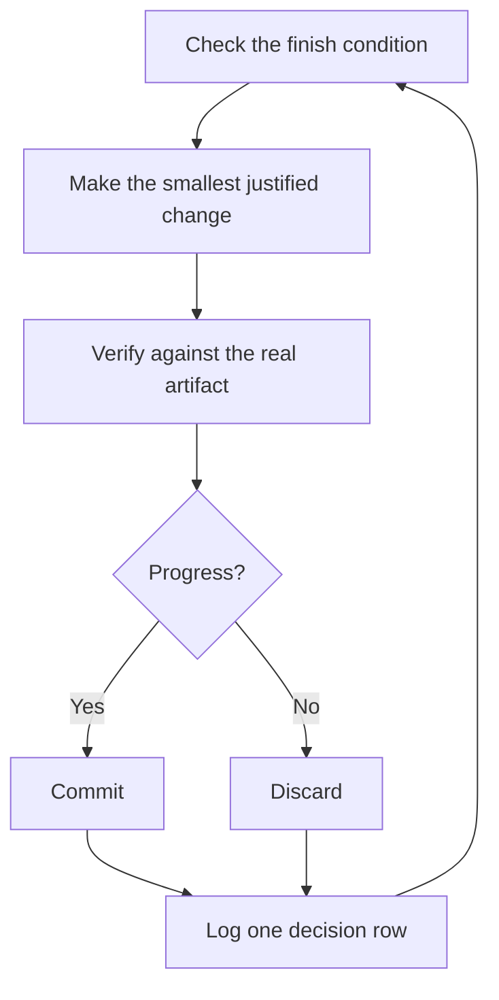

# Run work while you sleep

This is the payoff for everything before it. An agent you can trust to verify its own work is an agent you can leave alone with a hard task. What makes that safe isn't hope. It's a checkable finish condition, an isolated worktree, and a decision log you audit in the morning.


## Earn the trust before the loop

A loop you don't trust just produces unchecked work faster, and the mess compounds with every iteration. Before you leave one running, check that it has earned it:

- You've done the task once by hand, or watched an agent do it, so you know what good looks like.
- The agent has the tools and signals you'd use yourself: the verification skill, the profiler, the logs.
- Every stage proves its work and can stop the line when the work misses the bar.
- You've read a few transcripts and turned the repeated failures into tools, skills, or checks.

Make the loop autonomous only after all four hold. Until then, run it while you watch.

## The overnight contract

A good handoff has the goal, the finish condition, permissions, and an escape hatch. It doesn't need to be long:

```text
/maestro im going to bed. migrate every caller to the new parser in a fresh worktree off <base>.
done means zero old callers, all parser fixtures pass, old api deleted.
keep a decision log. don't ask me before committing.
/loop until done. if you're truly stuck after a few hours, stop and write up why.
```

Walk through what each line buys you:

- "im going to bed" is a session override. The agent stops asking and keeps going.
- "done means..." turns the goal into checks every iteration can run.
- "fresh worktree off `<base>`" keeps the run from colliding with anything else you have open.
- "don't ask me before committing" pre-answers the permission the agent would otherwise block on.
- `/loop` is Claude Code's built-in recurring-prompt skill, not a bottega skill. The [Autonomous run playbook](../../skills/maestro/playbooks/autonomous-run.md) uses it to re-check the finish condition on a heartbeat. A loop prompt is plain text that reads the skill, for example `/loop 10m Read <abs path>/skills/maestro/SKILL.md and continue the autonomous run playbook`.
- The escape hatch lets it stop at a genuine dead end and write up why, which beats eight hours of creative goal reinterpretation.

Because you'll review this work after stepping away, `/maestro` routes it through [`/figure-it-out`](../../skills/figure-it-out/SKILL.md), which designs the run's phases before any code and wires in the decision log.

To stop a run on purpose, tell the agent to pause, or that you're about to go offline or restart your machine. The [Pause safely playbook](../../skills/maestro/playbooks/pause-safely.md) finishes or backs out of the current step, saves a patch under `.bottega/` (no wip commit), and writes a resume note. A fresh chat picks the work up from that note through the Session pickup playbook. Saying "keep going" never triggers a pause.

## What the loop does all night



One change, one check, one log row, every iteration. Changes that didn't help get discarded, not left to ride. A plateau means pivot, not stop, and the finish condition never quietly relaxes to declare victory.

## The morning audit

[`/show-me-your-work`](../../skills/show-me-your-work/SKILL.md) is what makes the run reviewable. Each row records the time, phase, decision, reason, an evidence pointer, and the result, in a TSV at `decisions.tsv` (or `.audit/<task-slug>.tsv` when several runs share a directory). It stays local by default. Commit it when the work is ambitious enough that a reviewer needs the trail to trust the result.

When you're back, ask for the run in review form:

```text
/show-me-your-work catch me up on what you did last night
```

Before the skill hands back its summary, at high risk, or when the trail is committed, it spawns a reviewer on a different Claude tier than the parent to read the trail and the transcript, and the reply ends with an Attention section listing what deserves your scrutiny. Read that section first, then the log rows it points at. You're auditing decisions, not re-reading the whole night.

For a quick status instead of an audit, run [`/ketchup`](../../skills/ketchup/SKILL.md) in the chat that ran the work. It reads only, and tells you in plain words what changed since your last message, with any small diagrams the work produced. Then it lists each call waiting on you, such as a merge, an approval, or a choice between options, with its pick, the evidence, and the risk, so you can decide from the reply alone.

## When the night holds a queue, not a task

The contract above drives one task to one finish condition. Some nights hold more, a queue of independent changes or a whole program. Three playbooks scale the same trust up.

[Autopilot](../../skills/maestro/playbooks/autopilot.md) in `land` mode runs a queue of independent PRs to merged. Each PR gets one owner agent that carries it from build through merge, and no owner merges on its own verdict. A swarm of fresh verifiers checks the owner's code-ready head. A later rebase or minor fix gets one fresh verifier, and only new behavior or a large new diff calls the full swarm again. Only a clean verdict on the patch that merges authorizes the merge:

```text
/maestro full autopilot on this queue. each item is independent. i want them merged by morning.
```

`stack` mode is the same playbook without the merge. You wake up to verified PRs, each with its verdict, and you review and land them yourself. A PR stacks only on a PR it builds on. Pick it over `land` when you want your own eyes on the work before anything merges:

```text
/maestro autopilot these five changes, but don't merge. i'll land them in the morning.
```

[Orchestrate](../../skills/maestro/playbooks/orchestrate.md) is for a program that outlives any single agent: multi-day, many stacked PRs, fleets of subagents under one standing coordinator chat. The coordinator decides which agent does each piece of work, checks what each one produces, and never writes code itself. If one agent could finish the work in a session, the playbook itself routes you back to the overnight contract above:

```text
/maestro orchestrate the store migration. own it until every package is converted and merged. i'll check in twice a day.
```

## Run many tasks in parallel

Several runs can go at once, each in its own worktree on its own branch. Worktree runs share CPU, ports, and disk, so cap the fan-out at a handful. A few habits help:

- Give each body of work its own chat and worktree, such as a feature, a migration, a perf push, or a tech-debt cleanup.
- Give each PR a verification swarm before it merges, and let Autopilot carry the queue.
- Ask for a plan backed by data, and have the agent answer open questions with prototypes before it asks you.

One prompt can carry a whole effort, from research through execution:

```text
/maestro refactor this repo so its architecture is more agent friendly. use /correct and /architect on past commits and review comments to find the mistakes agents make most here. use /recall for context from past chats. answer open questions with prototypes instead of asking me. come back with a plan backed by real data. once i approve it, run it with autopilot, and ask me whether to land or stack.
```

When the destination is foggy and the work needs several sessions of decisions before a spec exists, use [`wayfinder`](../../skills/wayfinder/SKILL.md) to plan the effort as a map of decision tickets. When you want follow-ups from a run to survive it, [`file-followups`](../../skills/file-followups/SKILL.md) files them as GitHub issues after one confirmation from you.

**Pitfall:** a duration is not a finish condition. "work on this for 4 hours" gives the agent nothing to check, and you'll wake up to four hours of motion instead of a result. Give `/loop` a predicate that can pass or fail.

Next: [Steer with principle names](./08-principles.md).
